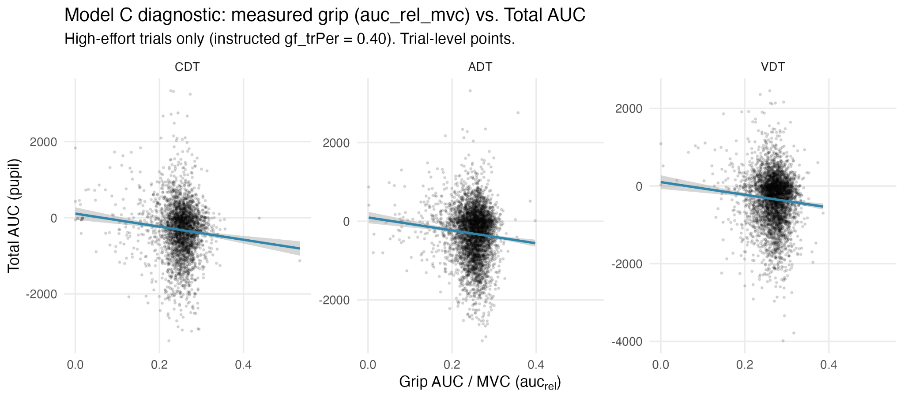
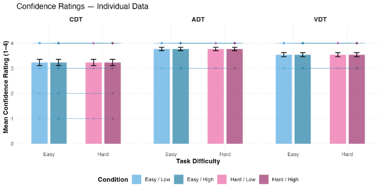

# Appendix A: Supplementary Materials for Chapter 1 {#sec-appendix-a}

## Section 1: Subjective Confidence Results

To examine whether subjective confidence was affected by concurrent demands or task difficulty and physical effort, we analyzed trial-level confidence ratings (4-point scale: 1 = least confident, 4 = most confident) using LMMs for each task.  As shown in @tbl-s1 and @fig-s1, confidence was consistently high across all tasks and conditions (*M* ≈ 3.5/4). We found no significant main effects of Task Difficulty, Physical Effort, or their interaction for the CDT, ADT, or VDT (all *p*s > .63).

: LMM Results for Subjective Confidence {#tbl-s1}

| Task | Predictor | b | p |
|---|---|---|---|
| CDT | Task Difficulty | 0.002 | .650 |
| CDT | Physical Effort | 0.0001 | .992 |
| CDT | Interaction | -0.001 | .972 |
| ADT | Task Difficulty | 0.0003 | .947 |
| ADT | Physical Effort | -0.002 | .636 |
| ADT | Interaction | 0.004 | .668 |
| VDT | Task Difficulty | -0.00003 | .998 |
| VDT | Physical Effort | 0.0004 | .965 |
| VDT | Interaction | -0.0003 | .962 |

{#fig-s1}

*Note.* The observed null effects likely reflect a significant ceiling effect in the rating distribution, as over 90% of responses were in the top two categories (3 or 4). This ceiling effect suggests that while objective performance was modulated by task difficulty, participants’ subjective sense of confidence remained uniformly high.

## Section 2: Random-Effects Structure

: Final Random-Effects Structure per Model {#tbl-s2}

| Model | Random-Effects Specification |
|---|---|
| CDT Accuracy | `(1 |
| CDT Reaction Time | `(1 |
| CDT Total AUC | `(1 + PhysicalEffort |
| ADT Accuracy | `(1 |
| ADT Reaction Time | `(1 |
| ADT Total AUC | `(1 |
| VDT Accuracy | `(1 + Difficulty * PhysicalEffort |
| VDT Reaction Time | `(1 |
| VDT Total AUC | `(1 + Difficulty * PhysicalEffort |

*Note.* All models were fit at the trial level . The specifications reflect the most complex structure that achieved convergence without singularity.

## Section 3: Evidence for the Null (Equivalence Testing)

To evaluate the strength of evidence for our non-significant results, we performed equivalence testing using the Two One-Sided Tests (TOST) procedure [@Lakens2018-fq]. This method allowed us to determine whether observed effects were statistically equivalent to zero within a pre-defined range of theoretically meaningful values.

**Smallest Effect Size of Interest (SESOI) Specification** We anchored our equivalence bounds to the interaction effect size (*d* = 0.79) reported in @Park2021-rs. This anchor was selected because it represents the only statistically significant Task Difficulty × Physical Effort interaction found in the younger adult population using an identical concurrent handgrip paradigm (5% vs. 40% MVC).

To ensure the bounds were appropriately calibrated for different statistical models, the standardized anchor was converted to unstandardized regression coefficients (*b*) for each outcome scale. This was achieved by multiplying the standardized effect by the standard deviation of the specific outcome measure (*b*SESOI = 0.79 × SDoutcome). The resulting bounds are as follows: Accuracy (±0.644 log-odds), log-transformed Reaction Time (±0.222), Total AUC (±136.3), and Cognitive AUC (±19.5).

**Results Summary** As shown in @tbl-s3 and @fig-s2, all 16 non-significant interaction terms and physical effort main effects on behavior passed the equivalence test (*p*TOST < .05). Even in the most conservative case (the ADT reaction time interaction; *p*TOST = .004), the observed effect was statistically equivalent to zero within our pre-defined meaningful threshold. These findings provide robust evidence that the reported null effects reflect a true absence of meaningful interaction rather than ambiguous data.

: Fixed-Effect Estimates and Equivalence Testing Results {#tbl-s3}

| Task | Outcome | Term | b | SE | 95%CI | p | pTOST | Equivalent? |
|---|---|---|---|---|---|---|---|---|
| CDT | Accuracy | Difficulty × Effort | -0.157 | 0.111 | [-0.373, 0.060] | .156 | < .001 | Yes |
| CDT | RT (log) | Physical Effort | 0.016 | 0.031 | [-0.046, 0.077] | .621 | < .001 | Yes |
| CDT | RT (log) | Difficulty × Effort | -0.010 | 0.044 | [-0.097, 0.078] | .831 | < .001 | Yes |
| ADT | RT (log) | Difficulty × Effort | -0.052 | 0.060 | [-0.169, 0.065] | .388 | .004 | Yes |
| VDT | Total AUC | Difficulty × Effort | -20.38 | 30.54 | [-80.23, 39.47] | .509 | < .001 | Yes |

{#fig-s2}

## Section 4: Continuous Measures of Physical Effort

To validate and extend the categorical analyses, we fit trial-level mixed-effects models replacing the binary Physical Effort condition with actual measured grip force (area under the trial-level force trace divided by each participant's maximum voluntary contraction, z-scored across all trials) as a continuous predictor, alongside Task Difficulty (Easy vs. Hard). Overall, the pattern of results was similar to those reported when using the categorical Physical Effort predictor, with exceptions noted below, suggesting slight differences in the sensitivity of these approaches to measuring grip force.

**Models for Accuracy and Reaction Time**

When the GLMMs on accuracy were repeated using actual measured grip force as a continuous predictor, results revealed significant main effects of Task Difficulty for all tasks, with lower accuracy on the Hard relative to Easy condition for CDT (*b* = −2.40, SE = 0.07, z = −34.84), ADT (*b* = −5.25, SE = 0.10, z = −50.04), and VDT (*b* = −3.39, SE = 0.23, z = −14.44; all ps < .001). There were no significant main effects of Physical Effort on accuracy (all *p*s > .16). There was a significant interaction between Task Difficulty and Physical Effort for CDT accuracy (*b* = −0.147, SE = 0.067, *p* = .029), whereby High effort was associated with worse accuracy on the Hard relative to Easy condition, but not for ADT or VDT (all *p*s > .42). This pattern of results was similar to those reported when using the categorical Physical Effort predictor, except for the significant interaction effect for CDT observed here.

When the LMMs on reaction time were repeated using actual measured grip force as a continuous predictor, results revealed significant main effects of Task Difficulty for ADT and VDT, with slower responses on the Hard relative to Easy condition for ADT (*b* = 0.219, SE = 0.052, *t* = 4.23; mean reaction time difference = 84 ms) and VDT (*b* = 0.207, SE = 0.054, *t* = 3.87; mean reaction time difference = 87 ms; both *p*s < .001), but not CDT (*p* > .55). There were no significant main effects of actual grip force on reaction time for any task (all *p*s > .49) and no significant interactions between Task Difficulty and actual grip force (all *p*s > .31). This pattern of results was similar to those reported when using the categorical Physical Effort predictor, except for the significant main effect of Physical Effort for VDT that was not observed here.

**Models for Total AUC**

When the LMMs for Total AUC were repeated using actual measured grip force as a continuous predictor, results revealed significant main effects of Physical Effort for all tasks, with larger Total AUCs for the High relative to Low effort condition for CDT (*b* = 102.83, SE = 19.71), ADT (*b* = 98.38, SE = 9.08), and VDT (*b* = 74.45, SE = 15.85; all ps < .001). There were no significant main effects of Task Difficulty and no significant interactions between Task Difficulty and Physical Effort for ADT or VDT (all ps > .07). This pattern of results was identical to those reported when using the categorical Physical Effort predictor.

**Models for Cognitive AUC (ADT and VDT only)**

When the LMMs for Total AUC were repeated using actual measured grip force as a continuous predictor, results revealed significant main effect of Task Difficulty for the ADT (*b* = −5.19, SE = 2.35, *p* = .027) and VDT (*b* = 6.79, SE = 2.73, *p* = .018), with a larger early pupil response in the Cognitive AUC window for Easy than Hard trials when trial-level variability was modeled. There were no significant main effects of Physical Effort (all *p*s > .10) or interactions between Task Difficulty and Physical Effort (all *p*s > .11) for ADT or VDT. This pattern of results was similar to those reported when using the categorical Physical Effort predictor, except for the significant main effect of Task Difficulty for VDT observed here.

**Continuous High Physical Effort and Pupil Response**

Additional analyses examined whether the main effects of Physical Effort on Total AUC for all tasks could be due to an artifact of the motor movement itself. There is evidence that the motor act of squeezing dilates the pupil [@Beatty1982-wg], which may result in larger Total AUCs for any squeeze regardless of actual measured grip force (i.e., an “all-or-nothing” artifact). Other evidence suggests that pupil size scales proportionally with effort [@Algermissen2024-od; @Van_der_Wel2018-ko]. Therefore, we analyzed the relationship between actual measured grip force and pupil size within High physical effort trials (Low effort trials may be susceptible to floor effects). Results revealed that greater measured force was associated with smaller (not larger) Total AUC in the CDT and ADT (*p*s ≤ .030; see @tbl-s5 and @fig-s3), with a marginal trend in the same direction for the VDT (*p* = .053). This finding suggests that, to the extent that a motion artifact is captured by the pupil, it would attenuate our main effects of physical effort, rather than drive it.

: Measured Physical Effort Predicting Pupil Response within High-Effort Trials {#tbl-s4}

| Task | Predictor | b | SE | 95% CI | p |
|---|---|---|---|---|---|
| CDT | auc_rel_mvc_scaled | −66.19 | 18.51 | [−102.48, −29.91] | .001 |
| ADT | auc_rel_mvc_scaled | −29.62 | 13.62 | [−56.32, −2.93] | .030 |
| ADT | Difficulty (Hard) | 18.74 | 18.01 | [−16.57, 54.04] | .298 |
| ADT | Difficulty × auc_rel_mvc_scaled | −10.22 | 18.10 | [−45.69, 25.25] | .572 |
| VDT | auc_rel_mvc_scaled | −52.49 | 26.23 | [−103.89, −1.08] | .053 |
| VDT | Difficulty (Hard) | −7.81 | 21.68 | [−50.31, 34.69] | .721 |
| VDT | Difficulty × auc_rel_mvc_scaled | 20.55 | 19.00 | [−16.69, 57.78] | .280 |

*Note.* The predictor auc_rel_mvc_scaled represents trial-by-trial measured grip force (area under the force trace divided by MVC), z-scored within the High-effort condition.

{#fig-s3}

## Section 5: Individual Difference Correlations

To examine whether individual variations in effort-related performance costs were associated with physiological arousal, we conducted a series of exploratory Pearson correlations. For each participant and each task, we calculated "difference scores" for accuracy and reaction time for both Task Difficulty (Hard minus Easy) and Physical Effort (High minus Low). These behavioral costs were then correlated with corresponding pupillary difference scores (Hard minus Easy Task Difficulty or High minus Low Physical Effort) for both Total AUC and Cognitive AUC. As summarized in @tbl-s6, no significant associations were observed between behavioral performance costs and pupillary metrics for any task. These results provide additional evidence that pupillary arousal does not modulate task difficulty- or physical effort-related performance decrements.

: Pearson Correlations Between Behavioral Costs and Pupillary Arousal {#tbl-s5}

| Behavioral Metric | Pupillary Metric | Comparison | r range | p range |
|---|---|---|---|---|
| Accuracy | Total AUC | Physical Effort (High–Low) | −.16 to −.06 | ps > .34 |
| Accuracy | Total AUC | Task Difficulty (Hard–Easy) | .07 to .19 | ps > .24 |
| Reaction Time | Total AUC | Physical Effort (High–Low) | −.08 to −.00 | ps > .65 |
| Reaction Time | Total AUC | Task Difficulty (Hard–Easy) | .04 to .25 | ps > .14 |
| Accuracy | Cognitive AUC | Physical Effort (High–Low) | −.08 to −.07 | ps > .63 |
| Accuracy | Cognitive AUC | Task Difficulty (Hard–Easy) | −.07 to .13 | ps > .43 |
| Reaction Time | Cognitive AUC | Physical Effort (High–Low) | −.12 to −.06 | ps > .46 |
| Reaction Time | Cognitive AUC | Task Difficulty (Hard–Easy) | .03 to .28 | ps > .10 |

## Section 6: Additional Statistics for GLMM and LMM Effects

@tbl-s6 provides regression coefficients (*b*), standard errors (SE), and 95% Wald confidence intervals for all fixed-effect estimates across the primary behavioral and pupillary models, in response to Reviewer 1's request for complete reporting of effect sizes and variability for all terms.

: Fixed-Effect Estimates for All Primary Models {#tbl-s6}

| Task | Outcome | Term | b | SE | 95% CI | p |
|---|---|---|---|---|---|---|
| CDT | Accuracy | Task Difficulty | −2.36 | 0.09 | [−2.54, −2.17] | < .001 |
| CDT | Accuracy | Physical Effort | −0.103 | 0.098 | [−0.30, 0.09] | .294 |
| CDT | Accuracy | Difficulty × Effort | −0.133 | 0.132 | [−0.39, 0.13] | .316 |
| CDT | Reaction Time | Task Difficulty | −0.019 | 0.031 | [−0.08, 0.04] | .551 |
| CDT | Reaction Time | Physical Effort | 0.006 | 0.031 | [−0.06, 0.07] | .848 |
| CDT | Reaction Time | Difficulty × Effort | 0.010 | 0.044 | [−0.08, 0.10] | .830 |
| CDT | Total AUC | Physical Effort | 226.78 | 40.92 | [146.58, 306.97] | < .001 |
| ADT | Accuracy | Task Difficulty | −5.26 | 0.13 | [−5.52, −5.00] | < .001 |
| ADT | Accuracy | Physical Effort | −0.133 | 0.110 | [−0.35, 0.08] | .227 |
| ADT | Accuracy | Difficulty × Effort | 0.025 | 0.160 | [−0.29, 0.34] | .878 |
| ADT | React ion Time | Task Difficulty | 0.253 | 0.041 | [0.17, 0.33] | < .001 |
| ADT | React ion Time | Physical Effort | 0.040 | 0.041 | [−0.04, 0.12] | .331 |
| ADT | React ion Time | Difficulty × Effort | −0.067 | 0.059 | [−0.18, 0.05] | .250 |
| ADT | Total AUC | Physical Effort | 204.87 | 17.99 | [169.60, 240.13] | < .001 |
| ADT | Total AUC | Task Difficulty | −26.11 | 17.99 | [−61.37, 9.16] | .147 |
| ADT | Total AUC | Difficulty × Effort | 6.91 | 25.44 | [−42.97, 56.78] | .786 |
| ADT | Cognitive AUC | Task Difficulty | −7.47 | 3.32 | [−13.99, −0.96] | .025 |
| ADT | Cognitive AUC | Physical Effort | −5.16 | 3.32 | [−11.67, 1.36] | .121 |
| ADT | Cognitive AUC | Difficulty × Effort | 4.56 | 4.70 | [−4.65, 13.77] | .332 |
| VDT | Accuracy | Task Difficulty | −3.39 | 0.25 | [−3.88, −2.89] | < .001 |
| VDT | Accuracy | Physical Effort | −0.085 | 0.164 | [−0.41, 0.24] | .602 |
| VDT | Accuracy | Difficulty × Effort | −0.042 | 0.185 | [−0.40, 0.32] | .820 |
| VDT | Reaction Time | Task Difficulty | 0.179 | 0.037 | [0.11, 0.25] | < .001 |
| VDT | Reaction Time | Physical Effort | 0.076 | 0.037 | [0.00, 0.15] | .040 |
| VDT | Reaction Time | Difficulty × Effort | 0.052 | 0.052 | [−0.05, 0.15] | .316 |
| VDT | Total AUC | Physical Effort | 165.11 | 35.00 | [96.51, 233.70] | < .001 |
| VDT | Total AUC | Task Difficulty | −10.47 | 20.55 | [−50.75, 29.82] | .614 |
| VDT | Total AUC | Difficulty × Effort | 20.38 | 30.54 | [−39.47, 80.23] | .509 |
| VDT | Cognitive AUC | Task Difficulty | 3.18 | 3.32 | [−3.33, 9.68] | .339 |
| VDT | Cognitive AUC | Physical Effort | −3.55 | 3.32 | [−10.05, 2.96] | .285 |
| VDT | Cognitive AUC | Difficulty × Effort | 7.22 | 4.69 | [−1.98, 16.42] | .124 |

*Note.* Accuracy models are GLMMs (binomial logit link); all other models are LMMs. Reaction time was log-transformed prior to analysis. CDT Total AUC includes Physical Effort only (Task Difficulty and its interaction were not tested for CDT because the probe stimulus occurs after the AUC measurement window). CDT Cognitive AUC was not computed for the same reason. All confidence intervals are 95% Wald intervals.
