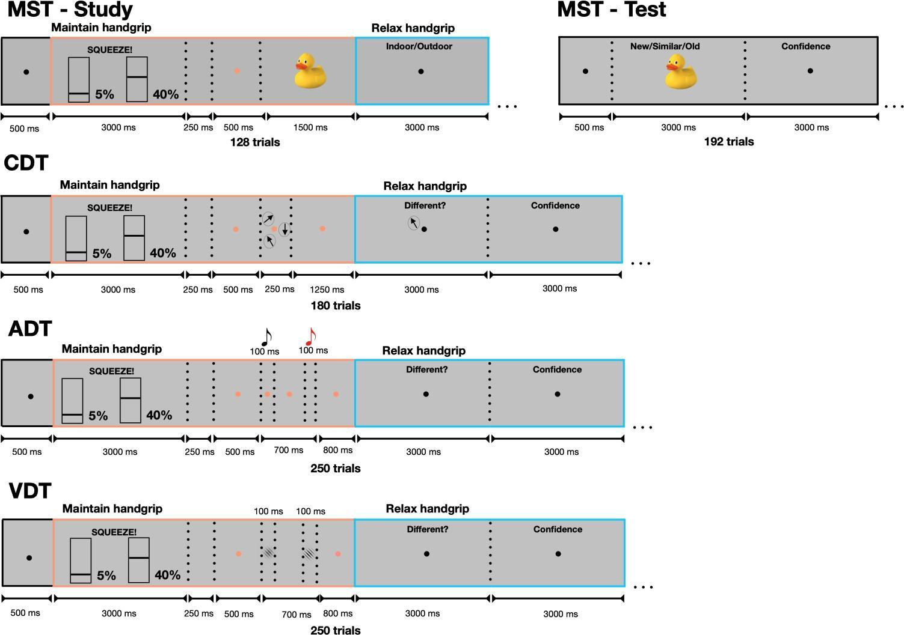

# Chapter 1: Effects of Concurrent Task Difficulty and Physical Effort on Memory and Perceptual Performance and Pupil Response in Younger Adults {#sec-chapter1}

**Authors:** Mohammad Dastgheib^1+^, Andrew Y. Sun^2+^, Kimia C. Yaghoubi^1^, Weiwei Zhang^1^, Megan A.K. Peters^3,4^, Ilana J. Bennett^*1^, Aaron R. Seitz^*1^

**Affiliations:** ^1^University of California, Riverside; ^2^Northeastern University; ^3^University of California, Irvine; ^4^Canadian Institute for Advanced Research

^+^co-first author; ^*^co-senior author

**Correspondence:** Mohammad Dastgheib; `mdast003@ucr.edu`

## Abstract

In daily life, cognitively demanding tasks are often performed while simultaneously exerting physical effort, yet the few studies that have examined their combined impact on performance have been limited to the working memory domain. This study systematically examined effects of concurrent task difficulty (Easy vs. Hard stimulus similarity) and physical effort (Low vs. High handgrip) on both behavioral performance and task-evoked pupil response in three cognitive tasks (visual working memory, auditory perception, visual perception) in healthy younger adults. Results revealed main effects of task difficulty on performance in all tasks, with participants being less accurate and slower in the Hard vs. Easy condition, and a main effect of physical effort on performance in the visual perception task, with participants being slower under High relative to Low effort. However, there were no interactions between task difficulty and physical effort for any task or performance metric. The pupil response showed only significant main effects of physical effort for all tasks, with larger pupil response during High vs. Low effort conditions. Individual-level analyses also revealed no significant correlations between these behavioral and pupillary responses. Overall, our findings do not support the notion that task difficulty and physical effort draw on common limited-capacity resources or that they similarly impact pupillary arousal, at least for the levels used here in healthy young adults.

## Significance Statement

In many real-world settings, people engage in cognitively demanding tasks while simultaneously exerting physical effort—for example, pushing a shopping cart while searching for items on our grocery list or gripping the steering wheel of a car while navigating through busy streets to reach a planned destination. Whether concurrent task difficulty and physical effort have interactive effects on task performance has been relatively understudied, despite practical implications for safety and performance in work, transportation, and everyday activities. The current study tested for these interactive effects across three cognitive domains (visual working memory, auditory and visual perceptual discrimination) in healthy younger adults. Our results showed that harder task difficulty impaired performance (lower accuracy, slower responses), whereas higher physical effort impaired performance (slower responses) and increased the pupil response. However, there were no interactions between task difficulty and physical effort. These findings have theoretical implications for the extent to which task difficulty and physical effort draw on shared resources or induce physiological arousal and practical implications for performance effects across a variety of real-world tasks with concurrent cognitive and physical demands.

*Keywords*: Task Difficulty, Physical Effort, Pupillometry, Arousal, Working Memory, Perceptual Discrimination

## Introduction

In the real world, we often perform cognitively demanding tasks while simultaneously exerting physical effort, such as pushing a shopping cart while searching for items on our grocery list or gripping the steering wheel of a car while navigating through busy streets to reach a planned destination. A much smaller literature has shown that concurrently manipulating task difficulty and physical effort can result in interactive effects on task performance [e.g., @Azer2023-ft; @Park2021-rs], although these investigations have been largely limited to the working memory domain [e.g., @Azer2023-ft; @Voelcker-Rehage2007-bm]. Thus, it remains unknown whether similar interactions are seen between perceptual task difficulty and concurrent physical effort.

Increasing task difficulty imposes a cognitive cost that manifests as observable performance decrements, specifically reduced accuracy or slower reaction times [@Westbrook2015-gy]. For example, in working memory tasks, participants perform worse on conditions that involve more to-be-remembered items (hard task difficulty) relative to conditions with fewer to-be-remembered items (easy task difficulty) [@Gazzaley2005-ib; @Van_Gerven2004-by; @Kahneman1966-jf; @Cowan2001-yv; @Vogel2004-im; @Cappiello2018-wv; @Salthouse1991-vr]. Similarly, for auditory [e.g., @Green1966-zu; @Naatanen1990-sz; @Zekveld2018-ng] and visual [e.g., @Beatty1982-wg; @Lavie1995-az; @Carrasco2011-wc] perceptual discrimination tasks, participants are less accurate when sounds or images are more similar to a target stimulus (hard task difficulty) than when they are less similar (easy task difficulty). Thus, increased task difficulty—whether through working memory load or perceptual similarity—consistently reveals performance costs across both memory and perceptual domains.

A well-controlled approach to measure physical effort is by using isometric handgrip exercises, in which participants are asked to maintain stationary grip force at a precise effort level, usually relative to their maximum voluntary contraction (MVC; [@Lind1967-tf]). Relative to mobility-based physical effort (e.g., walking; [@Hausdorff2008-st]; [@Plummer-D-Amato2012-ss]), isometric handgrip exercise captures real-world physical demands, such as carrying objects or gripping a steering wheel [@Azer2023-ft; @Eksioglu2008-ai]. Effects of physical effort on task performance are commonly studied asynchronously, that is, by comparing performance after versus before a period of handgrip exercise [@Brown2015-zu; @Washio2021-kg; @Saito2021-jx; @Yamada2021-bb; @Okamoto2022-mu]. For example, after exerting moderate-to-high handgrip levels (30, 50, and 70% of MVC; high physical effort), participants performed worse (made more errors) on a cognitive (Stroop) task relative to a control group that did not perform the handgrip manipulation (low physical effort; [@Brown2015-zu]). However, less is known about whether performance costs for (asynchronous) physical effort extend to working memory and perceptual tasks.

Our group is among the few that have examined effects of *concurrent* task difficulty and physical effort manipulations, with both studies examining working memory performance using visual search paradigms in younger adults. In one study [@Park2021-rs], we found a reaction time cost to the presence (hard task difficulty) versus absence (easy task difficulty) of a distractor that was larger for the moderate (40% of MVC) than low (5% of MVC) handgrip condition. However, in another study [@Azer2023-ft], younger adults showed performance costs (slower, less accurate) to harder task difficulty (distractor present vs absent), but no significant effect of physical effort (30% vs 5% of MVC) or interaction between task difficulty and physical effort. This may suggest that 40% MVC is a more appropriate moderate level for taxing physical effort in younger adults relative to the low effort 5% MVC baseline; although this claim would be strengthened by replicating the main effects and interaction in a new sample and by testing whether the interactive effects of task difficulty and physical effort are present for other cognitive domains beyond visual working memory, such as visual and auditory perception.

One might expect that the previously observed interaction between task difficulty and physical effort would be observed across multiple cognitive domains if they place demands on common underlying systems. This interpretation is consistent with a limited-capacity framework [@Kahneman1973-jw; @Wickens2008-pj], where simultaneous demands from hard task difficulty and high physical effort manipulations compete for a limited pool of top-down executive control resources. In our real-world examples, this may refer to executive control processes that coordinate navigating through busy streets while adjusting our grip on the steering wheel. Support for this view includes evidence that task difficulty and physical effort recruit overlapping prefrontal-mediated control systems for resource allocation during concurrent performance [@Blain2019-qk] even though they utilize distinct domain-specific neural pathways for task execution (Chong et al., 2017). Under this framework, concurrent exertion can interfere with performance when the combined demands exceed the capacity of these shared executive control resources. 

An alternative explanation rooted in Adaptive Gain Theory (Aston-Jones & Cohen,  Eldar et al.,  Sara & Bouret, ) is that simultaneously high task difficulty and high physical effort demands lead to excessive arousal, which in turn impairs performance. Support for this alternative view would be strengthened by using physiological measures of arousal, such as task-evoked pupil responses (TEPR)[@Gilzenrat2010-ye; @Joshi2020-il], and demonstrating that this marker of arousal is higher for hard versus easy task difficulty and high versus low physical effort conditions. Importantly, the limited-capacity framework and Adaptive Gain Theory accounts are not mutually exclusive; performance on tasks with concurrent demands may be modulated by both a competition for limited shared resources and general physiological arousal. 

The present study was designed to systematically investigate the effect of concurrent task difficulty (easy vs hard discrimination conditions using low vs high stimulus similarity) and physical effort (low vs high handgrip conditions using 5% vs 40% of MVC) manipulations across three distinct cognitive domains: visual working memory, auditory perception, and visual perception. Our primary aim was to replicate the consistent finding of worse performance for hard versus easy task difficulty in the concurrent task design, and conduct novel tests for both worse performance for high versus low physical effort conditions and for an interaction such that the task difficulty performance cost would be greatest for the high physical effort condition. Our secondary aim was to test whether pupil response (TEPR) showed similar effects of task difficulty, physical effort, and their interaction, as predicted by the Adaptive Gain Theory but not the limited-capacity framework. Relationships between task performance and pupil response were also examined.

## Methods

### Participants

Forty participants were recruited from fliers displayed at the University of California, Riverside and surrounding areas, social media, or word-of-mouth. To be eligible for this study, participants had to be between the ages of 18 and 30 years old, able to understand English, right-handed, have normal or corrected-to-normal visual acuity via contact lenses, and self-report having good overall health and cognitive ability. All participants provided informed consent and received monetary compensation for their participation. The study was approved by the Institutional Review Board of the University of California, Riverside. Two participants were excluded due to poor performance (i.e., mean accuracy on any of the three tasks that was more than three standard deviations below the group mean). This resulted in a final sample of 38 participants (M=22.9 years, SD=3.0 years, 57.8% Female).

### Experimental Design Overview

Participants completed four experimental sessions, three of which will be the focus of the current study because they involved tasks that concurrently manipulated task difficulty and physical effort in three cognitive domains (working memory, auditory discrimination, visual discrimination). Data from the fourth session using a long-term memory task is not included in the current study because task difficulty and physical effort were not manipulated concurrently. Session 1 began with informed consent followed by instructional videos detailing the isometric handgrip procedure and an overview of each cognitive task. Participants then completed the initial Maximum Voluntary Contraction (MVC) measurement followed by the first of the four cognitive tasks. Sessions 2-4 included MVC measurement followed by one of the three remaining tasks. The order of the tasks was counterbalanced across participants using a modified Williams design (Williams, . Sessions were separated by at least 24 hours with all sessions typically completed within 9 to 15 days.

### Maximum Voluntary Contraction

A Vernier hand dynamometer (Vernier Software & Technology, Beaverton, OR) was used to measure Maximum Voluntary Contraction (MVC) at the start of each testing session and to record hand grip for the physical effort manipulation in each cognitive task. In each testing session, average MVC was assessed by asking participants to squeeze the dynamometer as hard as possible for 5 seconds, repeating this process three times, and then averaging the three maximal contractions.

### Cognitive Tasks

All cognitive tasks were controlled by a Dell Alienware laptop running MATLAB R2021b with the Psychophysics Toolbox Version 3.0.18 (Brainard & Vision,  Kleiner et al.,  Pelli,  Stimuli were presented on a 19-inch ViewSonic PF817 CRT monitor (1280x960 resolution, 85 Hz refresh rate) viewed from a distance of 50 cm in a quiet, dimly lit room and screens were isoluminant across fixation periods. Responses were collected using designated keys on a standard QWERTY keyboard.

For each task, physical effort was manipulated on a trial-by-trial basis by cueing participants to exert Low (5% of their Session 1 MVC) or High (40% of their Session 1 MVC) force on the dynamometer and maintain that grip force until the response screen (~5.25s). Task difficulty was also manipulated on a trial-by-trial basis by systematically varying probe/target stimulus similarity relative to the studied/standard stimulus, with four levels of similarity that were averaged into Easy and Hard task difficulty conditions, as detailed next. Additional task details are described next and trial schematics are provided in Figure  

Accuracy and reaction time were recorded on each trial. Reaction time was measured from the onset of the response window for all tasks (blue box in @fig-task-schematics). For Change Detection Task (CDT), the arrow appeared at response window onset, whereas for Auditory Discrimination Task (ADT) and Visual Discrimination Task (VDT), the target stimulus was presented prior to the response window onset. Confidence ratings were also collected and are reported in the Supplementary Material (Section 1). 

{#fig-task-schematics}

A Change Detection Task (CDT; Cappiello et al., ) was used to assess visual working memory. On each of 180 trials, participants studied an array of three arrows surrounding a fixation After a brief delay, a single probe arrow appeared in one of the three locations in the same orientation as the studied arrow (20% of trial) or in one of four different orientations (20% of trials for each orientation). Participants indicated whether the probe arrow orientation was the same or different to the studied arrow in the same location. Task difficulty was manipulated by varying the magnitude of the orientation difference between the studied and probe arrows on "different" trials, binarized into Easy (large 45° or 90° rotations) and Hard (small 5° or 20° rotations) conditions.

An Auditory Discrimination Task (ADT; Murphy et al.,  Näätänen,  assess auditory frequency discrimination On each of 250 trials, participants heard a standard tone (1000 Hz) followed by either the same standard tone (20% of trial) or one of four different tones (20% of trials for each frequency offset). Participants indicated if the two tones were the same or different. Task difficulty was manipulated by varying the frequency difference between the standard tone and the target tone on “different” trials, binarized into Easy (large frequency offsets of +32 or +128 Hz) and Hard (small frequency offsets of +4 or +8 Hz) conditions.

A Visual Discrimination Task (VDT; [@Polat1994-nv]) was used to assess visual contrast discrimination. On each of 250 trials, participants viewed a standard Gabor patch (6 cycles/degree, 4° diameter, 100ms duration) followed by either the same standard Gabor patch (20% of trial) or one of four different Gabor patches (20% of trials for each contrast offset). Participants indicated if the two Gabor patches were the same or different. Task difficulty was manipulated by varying the contrast difference between the standard and the target Gabor patches on “different” trials, binarized into Easy (large contrast offsets of +0.16 or +0.32) and Hard (small contrast offsets of +0.04 or +0.08) conditions.

### Pupillometry

A tower-mounted EyeLink 1000 (SR Research) recorded left-eye pupil diameter at 1000 Hz (spatial resolution <0.01° RMS; pupil resolution 0.2%) while performing the task. Preprocessing followed current recommendations [e.g., @Mathot2018-ke; @Mathot2023-vj; @Laeng2024-li]: blinks were detected and padded, samples within masks were interpolated (short-gap PCHIP/linear), a light low-pass smoothing was applied (e.g., Savitzky–Golay), and data were then down-sampled to 100 Hz. 

To quantify the task-evoked pupil response (TEPR) given the concurrent physical effort and task difficulty demands of the tasks, we first generated full-trial pupil waveforms, adapted from @Zenon2014-ze, for all experimental conditions relative to a pre-trial baseline (B₀; 500 ms window). Area Under the Curve (AUC) was then calculated as the sum of the difference between the pupil waveform and the baseline across a time window, providing a single scalar summary of the magnitude of the baseline-corrected pupil diameter (in arbitrary units) [@Mathot2018-ke]. Total AUC was measured from trial onset until the start of the response window relative to the pre-trial baseline (blue boxes in @fig-task-schematics). Next, to isolate the TEPR specifically associated with the cognitive demand of the probe/target stimulus, we generated partial-trial pupil waveforms for all experimental conditions relative to a pre-probe baseline (500 ms window). Cognitive AUC was measured from 300 ms after probe onset until the start of the response window relative to the pre-probe baseline. The 300 ms onset was chosen to account for the typical latency of the task-evoked pupil response [@Mathot2018-ke]. Because the TEPR typically peaks 1–2 seconds post-stimulus [@da-Silva-Castanheira2021-lq], the Cognitive AUC window primarily captures only the initial pupillary response and it was therefore treated as an exploratory outcome measure. Note that Cognitive AUC was not calculated for CDT because the probe stimulus that indicated the task difficulty condition was presented after the AUC measurement window (i.e., during the response window). Prior to AUC calculation, trials were excluded if either baseline window contained insufficient valid data (≥10 samples required for baseline calculation; as in prior work [@Mathot2018-ke]).

### Statistical Analysis

All statistical analyses were conducted in R (Version 4.5.1). First, to assess the direct effects of Task Difficulty and Physical Effort on task performance, we fit trial-level generalized linear mixed models (GLMMs) for accuracy and linear mixed models (LMMs) for reaction time data from each task using the lme4 package in R [@bates2015fitting]. Second, to assess the effects of Task Difficulty and Physical Effort on the pupillary response, we fit separate LMMs for each AUC measure (Total, Cognitive) from each task. Following a "maximal" random-effects structure (Barr et al., 2013), models included random slopes for Task Difficulty, Physical Effort, and their interaction. If a maximal model was singular or failed to converge, we followed a principled reduction sequence by removing correlations between random effects and, if necessary, reverting to random intercepts ([@bates2015fitting]; Brauer & Curtin, 2018). The final random-effects structure for each model is reported in the Supplementary Material (Section 2) and the significance of fixed effects was determined using Wald tests from the model summaries.

To examine whether individual differences in Task Difficulty- and Physical Effort-related task performance were associated with physiological arousal (i.e., pupil response), we computed within-subject difference scores for each task condition (Hard minus Easy Task Difficulty, High minus Low Physical Effort) and then averaged these contrasts to obtain one value per participant for each effect. Behavioral measures included accuracy and mean correct reaction time; physiological measures included Total AUC and Cognitive AUC. Pearson correlations were conducted between the participant-level behavioral and AUC difference scores for each task, with 95% confidence intervals and two-tailed p-values reported.

Supplementary analyses evaluated the strength of evidence for null interaction and main effects with equivalence tests (TOST; Lakens, 2018) using effect size bounds derived from a prior study in our lab (*d* = 0.79; [@Park2021-rs]; Supplementary Material Section 3). Additional supplementary analyses fit the trial-level models to subjective confidence ratings, revealing no significant effects (Supplementary Material Section 1), and reran the trial-level models using continuous grip force measures, revealing effects similar to those when using categorical physical effort levels (Supplementary Material Section 4).  

**LLM/AI tool use**: Cursor [@Anysphere2025] was used to assist with code troubleshooting; all analyses and results were verified by the authors.

## Results

### Effects of Task Difficulty and Physical Effort on Task Performance

Separate GLMMs on accuracy (see @fig-performance, top row and Supplementary Material Section 6) revealed significant main effects of Task Difficulty for all tasks, with lower accuracy on the Hard relative to Easy condition for CDT (*b* = −2.36, SE = 0.09, z = −24.84), ADT (*b* = −5.26, SE = 0.13, z = −39.85), and VDT (*b* = −3.39, SE = 0.25, z = −13.37; all ps < .001). There were no significant main effects of Physical Effort (all *p*s > .23) and no interactions between Task Difficulty and Physical Effort (all *p*s > .16) for any task.

Separate LMMs on reaction time for each task (see @fig-performance, bottom row and Supplementary Material Section 6) revealed significant main effects of Task Difficulty for the perceptual tasks, with slower responses on the Hard relative to Easy condition for ADT (*b* = 0.25, SE = 0.04, *t* = 6.11; mean reaction time difference = 84 ms) and VDT (*b* = 0.18, SE = 0.04, *t* = 4.86; mean reaction time difference = 87 ms; both *p*s < .001), but not CDT (*p* > .55). There was also a significant main effect of Physical Effort for VDT (*b* = 0.076, SE = 0.037, t = 2.06, *p* = .040), with slower responses in the High compared to the Low physical effort condition. There were no significant main effects of Physical Effort for CDT or ADT (*p*s > .33) and no interactions between Task Difficulty and Physical Effort for any task (all *p*s > .25). Note that reaction time was log-transformed for analysis to meet model assumptions, but mean values and differences are reported in milliseconds for interpretability.

![Effects of Task Difficulty (Easy, blue bars; Hard, pink bars) and Physical Effort (Low, light bars; High, dark bars) on accuracy (proportion correct; top row) and reaction time (milliseconds; bottom row) for the Change Detection Task (CDT; left column), Auditory Discrimination Task (ADT; middle column), and Visual Discrimination Task (VDT; right column). Semi-transparent dots show individual participant means; lines connect the same participant across difficulty levels within each effort level. Error bars = standard error of the mean.](figures/chapter1/figure2_performance.png){#fig-performance}

### Effects of Task Difficulty and Physical Effort on the Pupillary Response

Pupil waveforms across the whole trial relative to the pre-trial baseline are provided for all experimental conditions in @fig-pupil-waveforms. Note that the waveform returned to baseline at ~8 seconds after trial onset. 

Separate LMMs for Total AUC (see @fig-auc-plots, top row and Supplementary Material Section 6) revealed significant main effects of Physical Effort for all tasks, with larger AUCs for the High relative to Low effort condition for CDT (*b* = 226.78, SE = 40.92, *t* = 5.54), ADT (*b* = 204.87, SE = 17.99, *t* = 11.39), and VDT (*b* = 165.11, SE = 35.00, *t* = 4.72; all *p*s < .001). There were no significant main effects of Task Difficulty (all *p*s >.147) and no significant interactions between Task Difficulty and Physical Effort for ADT or VDT (all *p*s > .509; CDT was not considered for difficulty effects due to its AUC measurement window not including the probe stimulus).

Separate LMMs for the exploratory Cognitive AUC metric revealed a significant main effect of Task Difficulty for the ADT (*b* = −7.47, SE = 3.32, *t* = −2.25, *p* = .025), with a larger early pupil response in the Cognitive AUC window for Easy than Hard trials when trial-level variability was modeled, but not for the VDT (*p* > .33). There were no significant main effects of Physical Effort (all *p*s > .121) or interactions between Task Difficulty and Physical Effort (all *p*s > .124) for ADT or VDT.

![Effects of Task Difficulty (Easy, blue lines; Hard, pink lines) and Physical Effort (Low, light lines; High, dark lines) are shown on pupillary response waveforms for the Change Detection Task (CDT; top), Auditory Discrimination Task (ADT; middle), and Visual Discrimination Task (VDT; bottom). Waveforms are presented as change relative to a 500 ms pre-trial baseline with smoothed generalized additive model (GAM) trajectories with 95% confidence intervals derived from subject-level means. Vertical dashed lines indicate trial onset, median onset of the cognitive task (Arrow/Stimulus), and response window onset.](figures/chapter1/figure3_pupil_waveforms.png){#fig-pupil-waveforms}

![Effects of Task Difficulty (Easy, blue bars; Hard, pink bars) and Physical Effort (Low, light bars; High, dark bars) on pupillary response metrics. The top row illustrates Total AUC for the Change Detection Task (CDT; left), Auditory Discrimination Task (ADT; middle), and Visual Discrimination Task (VDT; right), reflecting the overall pupillary response integrated from squeeze onset to response onset. The bottom row displays the exploratory Cognitive AUC for the ADT and VDT, capturing the partial-trial pupillary response integrated from 300 ms post-stimulus onset until response window onset relative to a localized pre-stimulus baseline. Note that the CDT is excluded from the Cognitive AUC analysis because its probe was presented within the response window. Semi-transparent dots show individual participant means; lines connect the same participant across difficulty levels within each effort level. Error bars = ±SEM. Y-axes do not begin at zero to maximize the visibility of condition differences.](figures/chapter1/figure4_auc_plots.png){#fig-auc-plots}

### Individual Differences

Relationships between behavioral difference scores (Hard minus Easy Task Difficulty or High minus Low Physical Effort for accuracy and reaction time) and corresponding pupillary difference scores (Hard minus Easy Task Difficulty or High minus Low Physical Effort for Total AUC and Cognitive AUC) revealed no significant correlations (all *p*s > .10; see Supplementary Material Section 5).

## Discussion

The present study extended prior research by systematically examining the effect of concurrent task difficulty (less similar/Easy vs. more similar/Hard) and physical effort (5% MVC/Low vs. 40% MVC/High) on behavioral performance and pupil responses across three cognitive domains: visual working memory, auditory perception, and visual perception. Our behavioral results replicated main effects of task difficulty on performance across all three tasks, with less accurate responses across all tasks and slower responses for the perception tasks when discriminating between more similar (hard) relative to less similar (easy) stimuli. A main effect of physical effort was only seen for the visual perception task, with slower responses when exerting high relative to low effort. In contrast, pupillary responses revealed main effects of physical effort for all tasks, with larger Total AUC when exerting high relative to low effort, whereas a main effect of task difficulty was only seen for the exploratory Cognitive AUC during the auditory perception task. Importantly, we observed no significant interactions between task difficulty and physical effort for performance or pupillary responses on any task. These findings in a healthy younger adult sample contradicted predictions of both limited-capacity resource and Adaptive Gain theories and instead suggest that task difficulty and physical effort independently influence performance and pupillary responses across working memory and perceptual domains.

As predicted, we observed robust main effects of task difficulty on behavioral performance across all three cognitive tasks, with less accurate responses across all tasks, and slower responses for the auditory and visual perception tasks during Hard trials compared to Easy trials. This pattern of results replicated a large and foundational body of literature demonstrating the classic effects that working memory performance is worse when memory load is higher [e.g., @Gazzaley2005-ib; @Kahneman1966-jf] and that perceptual discrimination for both auditory [e.g., @Green1966-zu; @Naatanen1990-sz] and visual [e.g., @Beatty1982-wg] stimuli is worse when similarity between targets and non-targets is higher. Beyond simple replication, a key strength of the current study is that we demonstrated these task difficulty effects across three distinct cognitive domains—visual memory, auditory perception, and visual perception—within the same sample of participants. 

In contrast to the robust effects of task difficulty, we only observed a main effect of physical effort for the visual perception task, with slower responses for high relative to low effort trials. This is not consistent with prior work from our group in which we have found both the opposite (40% vs. 5% of MVC; [@Park2021-rs]) or no significant effect (30% vs. 5% of MVC; [@Azer2023-ft]) of physical effort on working memory performance using visual search paradigms in younger adults. We speculate that the low-to-moderate levels of physical effort used by our group may not be sufficiently demanding to consistently produce behavioral costs in younger adults, even though the High physical effort condition did elicit a larger pupil response compared to the Low physical effort condition. Consistent with this interpretation, the asynchronous physical effort literature that has shown impaired task performance following handgrip exercise used moderate-to-high levels of physical effort (e.g., 30-70% MVC in Brown & Bray, 2015). An alternative possibility is that physical effort effects are small, if present at all, when there are concurrent task demands. For example, a fatiguing concurrent handgrip protocol was found to have no effect on an inhibitory control task (Eriksen Flanker; [@Thibault2019-hg]) and concurrent cycling (even at hard intensity) had no effect on a related task (Go/No-Go; [@Blakely2023-bl]). In line with this interpretation, analyses using actual measured grip force (Supplementary Material Section 4) still revealed no significant effect of grip force on performance in any task. Additional research is needed to understand whether, and under what conditions, physical effort influences cognitive performance in younger adults.   

Of particular interest in the current study was whether there was an interaction between task difficulty and physical effort on task performance, which we did not observe for any task. This finding is consistent with one of our prior studies [@Azer2023-ft], but not with the other in which effects of task difficulty (distractor present vs. absent) were larger for moderate compared to low physical effort conditions [@Park2021-rs]. While a main effect of physical effort on cognitive performance may indicate some degree of cross-domain interference [@Kahneman1973-jw; @Navon1979-jk; @Wickens2008-pj], a stricter interpretation of the limited-capacity framework would predict that simultaneous demands from hard task difficulty and high physical effort conditions should overwhelm a finite shared resource pool [@Kahneman1973-jw; @Wickens2008-pj], resulting in the performance cost of task difficulty to be disproportionately amplified under high physical load. The Adaptive Gain Theory would similarly predict that these combined conditions would lead to excessive arousal that would in turn impair performance [@Aston-Jones2005-dg; @Eldar2013-zg; @Sara2012-cb]. Because we observed no such interactions across any task or performance metric, our findings do not support the conclusion that these domains (task difficulty, physical effort) share resources in healthy younger adults.

To further test the Adaptive Gain Theory interpretation, we examined effects of task difficulty, physical effort, and their interaction on the pupil response (Total AUC). Although there were no significant task difficulty or interaction effects, we did observe significant effects of physical effort on all three tasks, with larger Total AUCs during High (40% MVC) compared to Low (5% MVC) physical effort conditions. Similarly, when using continuous measures of physical effort (Supplementary Material Section 4), we found that higher actual measured grip force related to larger pupillary responses for all tasks. This demonstrates that our physical effort manipulation successfully increased physiological arousal during each task. Importantly, additional analyses suggest that these findings are not due solely to an artifact of the motor movement itself. There is some evidence that the motor act of squeezing dilates the pupil [@Beatty1982-wg], which may result in larger Total AUCs for any physical effort level regardless of actual measured grip force (i.e., an “all-or-nothing” artifact), whereas other evidence suggests that pupil size should scale proportionally with effort [@Algermissen2024-od; @Van_der_Wel2018-ko]. Yet, when examining the High Effort condition only, higher actual measured grip force was significantly associated with smaller (not larger) pupillary responses for the perceptual tasks (Supplementary Material Section 4). This finding suggests that, to the extent that a motion artifact is captured by the pupil, it would attenuate our main effects of physical effort, rather than drive it.

Exploratory analyses with the Cognitive AUC metric revealed a different pattern of results, with a significant effect of task difficulty for the ADT, but no physical effort or interaction effects for either perceptual task. However, because the task-evoked pupil response typically peaks 1–2 seconds post-stimulus [@Mathot2018-ke], this partial-trial measurement window may have captured only the onset phase of the pupillary response to task difficulty and should therefore be interpreted with caution. 

Finally, our individual differences analyses failed to reveal any significant associations between task difficulty- or physical effort-related changes in task performance and the corresponding changes in pupil response. Taken together with the lack of significant interactions, our findings for the pupil responses do not support an Adaptive Gain interpretation. Instead, our data indicate that task difficulty and physical effort may differentially contribute to behavioral performance and the pupil response, respectively, in concurrent tasks (i.e., performance was more consistently modulated by task difficulty, but not physical effort). This interpretation is consistent with prior work showing that pupil dilation does not consistently relate to behavioral performance [e.g., @Van_der_Wel2018-ko]. Alternatively, our results may reflect a limitation of our task design (see below).

A key strength of the current study is that it is the first to examine concurrent effects of task difficulty and physical effort across multiple cognitive domains. Yet it is not without limitations. For example, task difficulty was manipulated using similarity between the studied/standard and probe/target stimuli, which was revealed late in our tasks–either at the onset of the probe (CDT) or target stimulus (ADT and VDT). This differs from classic working memory paradigms (e.g., standard n-back or Sternberg tasks; [@Kahneman1966-jf]; [@Westbrook2015-gy]) where task difficulty (load) is sustained throughout the trial. One implication of this methodological choice was that we could not examine the Cognitive AUC in the CDT as the probe stimulus was revealed during the response period (i.e., after the measurement window of the pupil response). We also elected to use two levels of physical effort based on our prior work, but those low-to-moderate levels may not have been high enough to induce the type of excessive arousal that impairs performance in the healthy younger adult population examined here as predicted by the Adaptive Gain Theory [@Aston-Jones2005-dg]. Additional research using higher (or a larger range of) physical effort levels, other methods for modelling performance (e.g., psychometric curves), or examining populations with well-documented dual-task challenges (such as older adults; [@Lindenberger2000-aw]; [@Woollacott2002-ur]) is needed to further test for the performance costs and interactions of interest, but not observed, here. Future work might consider comparing “macro-effort” using handgrip with "micro-effort" gaze effects reported in the oculomotor literature [@Gottlieb2013-mp; @Sullivan2012-rp; @Wang2021-gq]. Future research may also benefit from exploring other measures of physiological arousal (e.g., Galvanic skin response).

**Conclusions**

In summary, the current study sought to examine the concurrent effects of task difficulty and physical effort on visual working memory, auditory perception, and visual perception performance and pupil responses. Performance was worse (lower accuracy, slower reaction times) for the Hard versus Easy task difficulty condition for all tasks, and for the High versus Low physical effort condition for the visual perception task. The pupil response was larger for the Hard versus Easy task difficulty condition for the auditory perception task (exploratory Cognitive AUC), and for the High versus Low physical effort condition for all tasks (Total AUC). However, there were no significant interactions between task difficulty and physical effort for performance or pupil response outcomes, and no relationships between the effort effects on performance and pupil responses. Thus, our findings do not support a limited-capacity resource or an excessive arousal interpretation. Instead, our findings suggest that task difficulty and physical effort rely on distinct cognitive resources, at least for the low-to-moderate physical effort levels studied here in a healthy young adult population.

**List of abbreviations**

ADT: Auditory Discrimination Task

VDT: Visual Discrimination Task

## List of Abbreviations

- **CDT**: Change Detection Task
- **AUC**: Area Under the Curve
- **TEPR**: Task-evoked pupil response
- **MVC**: Maximum voluntary contraction
- **IRB**: Institutional Review Board
- **GLMM**: Generalized linear mixed-effects model
- **LMM**: Linear mixed-effects model
- **GAM**: Generalized Additive Models

## Declarations

**Funding**: This work was supported by NIA (Grant No. NIH/NIA R01AG072607). The funder had no role in study design, data collection, analysis, decision to publish, or manuscript preparation.

**Ethics approval and consent to participate:** All procedures were approved by the Institutional Review Board at the University of California, Riverside (Protocol No. HS-21-055). All participants provided written informed consent prior to participation.

**Consent for Publication: **Not applicable

**Availability of data and materials: **De-identified behavioral and pupillometry data are available from the corresponding author upon reasonable request. Analysis code and study materials are available via Zenodo (https://doi.org/10.5281/zenodo.20498484)

**Competing interests:** The authors declare that they have no competing interests.

**Authors’ contributions**: 

Conceptualization: WBZ, MAKP, IJB, ARS. Data curation: MD, AYS, KCY. Formal analysis: MD. Funding acquisition: WBZ, MAKP, IJB, ARS. Investigation: MD. Methodology: WBZ, MAKP, IJB, ARS. Project administration: WBZ, MAKP, IJB, ARS. Resources: ARS. Software: MD, ARS. Supervision: WBZ, MAKP, IJB, ARS. Validation: IJB, ARS. Visualization: MD. Writing—original draft: MD. Writing—review & editing: MD, WBZ, MAKP, IJB, ARS.

*MD and AYS contributed equally.

**Acknowledgements: **We thank Hadi Kobaissi and Jacqueline Alba for assistance with data collection.

## Open Practices Statement

**Materials/code availability**: Analysis code and study materials are publicly available via Zenodo (https://doi.org/10.5281/zenodo.20498484) and the associated GitHub repository.

**Data availability**: De-identified data are available from the corresponding author upon reasonable request (subject to any IRB/consent constraints).

**Preregistration**: This study was not preregistered.
